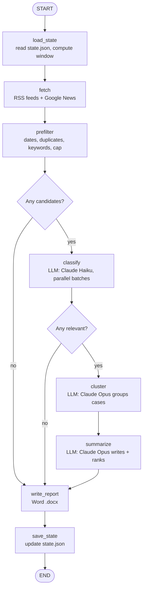

# Press Review Agent — Security Screening Watch (Canada / Québec)

A Python agent built with **LangChain** and **LangGraph** that scans major Canadian news outlets for stories
about **security-screening failures** and writes a dated **Word report** with a short summary and links to every
article.

A "security-screening story" is any case where a person in a position of trust passed, bypassed or abused a
screening process (with or without charges), or where the screening system itself failed. Examples:

- an employee illegally looking up or selling customer records;
- a police officer linked to organized crime;
- a candidate with an undisclosed criminal record;
- an impostor practising as a nurse;
- an inmate released by mistake;
- an audit report on deficient background checks.

The agent reads French and English sources, writes its report in French, and gives priority to Québec while
still covering the rest of Canada.

> **Status:** v1 (preliminary). Sources are free RSS feeds plus Google News search. The architecture is designed
> to plug in a paid news-search API later.

---

## What it does

Every time it is launched (double-click on the `.exe`, or `python main.py`), the agent:

1. **Finds out when it last ran** (`state.json`) and searches from that date. The window is capped at **30 days**,
   including on the first run.
2. **Collects** articles from the RSS feeds of 11 major outlets (Radio-Canada, La Presse, Le Devoir, Journal de
   Montréal, TVA Nouvelles, Noovo Info, CBC, Globe and Mail, CTV News, Global News, The Canadian Press via
   partner outlets) and from targeted Google News queries in French and English.
3. **Pre-filters** without AI: date window, exact duplicates, a broad keyword list and a cost cap.
4. **Classifies** each remaining article against explicit INCLUDE / EXCLUDE criteria (LLM).
5. **Groups** articles about the same case, so 5 outlets covering one story become **one entry with 5 links**.
6. **Writes** a French title and a 2–3 sentence summary for each case, plus an overall summary. Cases are sorted by
   importance, with Québec first when importance is equal.
7. **Saves** `revue_securite_YYYY-MM-DD.docx` next to the executable. When nothing new is found, the report says so
   explicitly: *« Aucun nouvel article trouvé depuis le JJ/MM/AAAA »*.
8. **Updates** `state.json`, but only if the report was written **and** at least one source answered.

## How it delegates the work

The core design rule is that **code does everything deterministic and the LLM only does what needs judgment**.
The control flow is a fixed LangGraph graph. The model never decides what runs next.



| Task | Done by | Why |
|---|---|---|
| Time window, "since last run" | Code (`revue/state.py`) | Must be exact and testable |
| Fetching articles | Code (`revue/sources/`) | Reliable and free. The model never chooses URLs, which shrinks the prompt-injection surface |
| Date filter, exact duplicates, keywords, cost cap | Code (`revue/prefilter.py`) | Removes most of the noise for free before any LLM call |
| Routing (skip the LLM when there is nothing to analyze) | Code (LangGraph conditional edges) | No wasted calls, predictable cost |
| "Is this a security-screening story?" plus scope (Québec / Canada), stage and importance | **Claude Haiku** (`revue/classifier.py`) | High-volume judgment task: a cheap, fast model, 15 articles per call, batches in parallel |
| "Which articles describe the same case?" | **Claude Opus** (`revue/clustering.py`) | Cross-language, cross-outlet matching needs a stronger model. It runs once per launch |
| French titles, summaries, overview | **Claude Opus** (`revue/summarizer.py`) | Quality writing, translation from English. It runs once per launch |
| Validating every LLM output | Code | Unknown IDs dropped, missing items re-classified, scores clamped, every article assigned exactly once |
| Final decision | **A human reader** | The report is a triage aid, not an automated verdict |

All LLM calls go through one small interface (`LLMClient.structured()` in `revue/llm.py`). It uses LangChain's
`with_structured_output(..., method="json_schema")`, so every answer comes back as a validated **Pydantic**
object instead of free text.

## Why it is built this way

| Decision | Reason | Trade-off accepted |
|---|---|---|
| **Workflow, not an autonomous agent** | The task is predictable (collect, sort, group, write). A fixed graph gives predictable cost and runtime, and it is testable and debuggable. This follows the "start with the simplest thing that works" advice for agentic systems | It will not "dig deeper" on its own. The search queries are fixed in `config.yaml` |
| **Two models** (Haiku to sort, Opus to write) | Sorting hundreds of articles is cheap on a small model. Grouping and writing benefit from a stronger one | Two models to evaluate and maintain |
| **Keyword pre-filter before the LLM** | Cuts LLM cost by an order of magnitude | An article with none of the keywords is never seen (it can be disabled) |
| **Native structured output** (`json_schema`) | Recent Claude models reject forced tool calls, so native structured output is the reliable path | Tied to providers that support it (Anthropic, OpenAI) |
| **State saved only at the very end** | A crash or an offline run never "loses" a period: the next launch re-covers it | A crash after the report is written means that period gets processed twice |
| **Graceful degradation** | A dead feed is logged and listed in the report and does not stop the run. If *all* sources fail, the report says **collection failed** instead of "nothing new" | — |
| **Untrusted input handling** | Articles are web content and could carry prompt injection. The LLM has **no tools and no actions**, its outputs are schema-constrained and checked by code, and a human reads the result | — |
| **Dependency injection** (LLM, HTTP fetcher, clock) | The whole graph runs offline in tests with a fake LLM and frozen RSS fixtures | Slightly more plumbing |
| **Evaluation separate from tests** | Tests check deterministic code. A labeled dataset measures model behaviour (recall first: missing a case costs more than a false alarm) | The dataset must be maintained |

## Quick start (Windows)

1. Install **Python 3.11+** from python.org and tick *"Add python.exe to PATH"*.
2. Run `installer.bat`. It creates `.venv` and installs the pinned dependencies.
3. Set your Anthropic API key, preferably as an environment variable (see [API key](#api-key)).
4. Check the feeds. RSS URLs change over time, so do this first:

   ```bash
   lancer.bat --verifier-flux
   ```

5. Run the agent by double-clicking `lancer.bat`, or build a standalone executable with `build_exe.bat`, which
   produces `dist\RevueSecurite.exe`. Copy it **together with `config.yaml`** to the folder of your choice.

On Linux or macOS:

```bash
python -m venv .venv
```

```bash
source .venv/bin/activate
```

```bash
pip install -r requirements.txt
```

```bash
python main.py
```

## Commands

| Command | Effect | Updates `state.json` |
|---|---|---|
| `RevueSecurite.exe` / `python main.py` | Normal run | Yes |
| `--verifier-flux` | Tests every RSS feed and one Google News query, then exits (no LLM call) | No |
| `--depuis 2026-11-01` | Forces the start date (replay a period) | No |
| `--fake-llm` | Offline demo without an API key (keyword rules only, report marked "do not share") | No |
| `--sans-pause` | Does not wait for *Enter* at the end (for Windows Task Scheduler) | Yes |
| `--config other.yaml` | Uses another configuration file | Yes |
| `python -m pytest` | 22 offline tests, about 1 second, free | — |
| `python -m evaluation.run_eval` | Evaluates classification and grouping with the real LLM | — |
| `python -m evaluation.run_eval --fake` | Same, with the keyword baseline (free) | — |
| `python -m evaluation.run_eval --min-rappel 0.9` | Exits with code 1 if recall is below 90 % | — |

## Configuration

Everything that changes in normal operation lives in **`config.yaml`**: models, RSS feeds, accepted Google News
domains, search queries, keywords, cost cap, 30-day window and report options. The file is read at every launch,
so **editing it never requires rebuilding the `.exe`**. Changing any `.py` file (for example the screening
criteria in `revue/prompts.py`) does.

To switch providers, set `llm.provider: openai` and change the two model names.

### API key

The agent reads `llm.api_key` in `config.yaml` first, then falls back to the `ANTHROPIC_API_KEY` environment
variable (or `OPENAI_API_KEY`). **Use the environment variable and leave `api_key: ""` empty in the repository.
Never commit a key.**

Windows (PowerShell, persistent for your user):

```bash
setx ANTHROPIC_API_KEY "sk-ant-..."
```

## Tests and evaluation

- **Tests** (`tests/`): 22 offline tests with frozen RSS fixtures and a fake LLM. They cover:
  - the 30-day cap, a corrupted state file, dead sources and duplicate merging;
  - an LLM that "forgets" or invents items;
  - a second run that finds nothing new;
  - a failing LLM, which must not save state;
  - all sources down, which must report a failure rather than "nothing new".
- **Evaluation** (`evaluation/`): labeled cases (`dataset.jsonl`) and grouping cases (`clustering_cases.jsonl`).
  It reports recall, precision, F1, Québec/Canada accuracy and pairwise grouping precision and recall, and writes
  the results to `evaluation/resultats/`.

> **Known weakness:** the bundled dataset only contains **23 constructed, fictional cases**. A simple keyword
> baseline already reaches ~86 % recall on it, which shows it is too easy. Replace it progressively with real,
> labeled articles, especially the ones the agent missed (the report's appendix lists every article the AI
> rejected). Aim for 100+ real cases before trusting the numbers.

## Project layout

```text
main.py                     entry point, CLI options, logging
config.yaml                 all runtime configuration
revue/graph.py              LangGraph workflow (nodes, conditional edges)
revue/state.py              state.json and the 30-day window
revue/sources/              base.py (Source interface), rss.py, google_news.py, factory.py
revue/prefilter.py          dates, URL normalization, exact duplicates, keywords, cost cap
revue/prompts.py            screening definition, INCLUDE/EXCLUDE criteria, grouping and writing instructions
revue/llm.py                LangChain models, structured output, retries
revue/classifier.py         LLM step 1: relevance (parallel batches)
revue/clustering.py         LLM step 2: grouping cases
revue/summarizer.py         LLM step 3: writing, merging, ranking
revue/report.py             Word report (clickable links, appendices)
revue/fake_llm.py           offline fake LLM (tests, demo, evaluation baseline)
tests/                      pytest suite and fictional RSS fixtures
evaluation/                 labeled datasets and run_eval.py
exemple/                    sample report generated offline from the fictional fixtures
docs/                       full user and maintenance documentation (PDF, French)
installer.bat, lancer.bat, build_exe.bat   Windows helpers
```

## Documentation

The full **user and maintenance guide** (French, 13 pages) is in
[`docs/Documentation_Agent_Revue_Securite.pdf`](docs/Documentation_Agent_Revue_Securite.pdf). It covers:

- installation, daily use and all commands;
- every `config.yaml` key;
- step-by-step troubleshooting: dead RSS feeds, total collection failure, Google News blocking, API errors
  (401 / 429 / retired model), too many false positives or misses, cost;
- plugging in a paid search API, scheduling, updating dependencies and a maintenance routine.

## Known limitations

- **RSS URLs were written without live testing.** Run `--verifier-flux` after installing and fix any feed marked
  `ÉCHEC` (see section 6.1 of the documentation).
- **Short RSS history:** outlet feeds keep only a few days of articles. Beyond that, coverage relies on Google News
  RSS search. That use is unofficial, capped at 100 results per query, and can change or be blocked at any time.
  A paid search API is the real fix.
- **Paywalls:** only public titles and leads are used, so summaries stay short. Always check the source article.
- **No case memory yet:** a story that develops over several days shows up again without a "follow-up" label.
- Summaries are AI-generated from headlines and leads and can contain errors. **The report is a triage aid that
  must be reviewed by a human.**

## Tech stack

Python 3.11+ · LangGraph 1.2 · LangChain Core 1.8 · langchain-anthropic 1.7 (Claude Haiku 5.5 / Claude Opus 5.5) ·
optional langchain-openai · feedparser · python-docx · Pydantic 2 · pytest · PyInstaller (Windows build)
